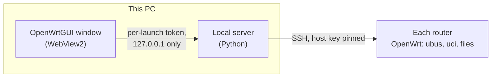

# OpenWrtGUI

**Operate the OpenWrt routers of a Wi-Fi test bench from one Windows window, without SSH.**

A Wi-Fi test bench uses OpenWrt routers as access points. Until now every change on them meant an SSH
session or a harness script, and the routers' own web UI (LuCI) is slow to use and knows nothing about
the bench's custom tools. OpenWrtGUI shows every bench router in one desktop app: what is on air, who
is connected, and how each router describes itself. It never disturbs a test run that is in progress.

> v0.6 adds the LTE modem: registration, operator and signal with quality labels and live charts, the LTE
> settings with rollback, connect, disconnect, a safe modem reboot, and an AT console. It also adds the
> System screen: overview, live load and traffic, logs, processes, diagnostics, host name and time,
> services and rc.local, scheduled tasks, a backup and a reboot proven by a fresh uptime.
> v0.5 added image import and Discovery: import a router's sysupgrade image and see what changed on the
> router since flashing, the bench's own packages and programs as cards, and flash a router from an image.
> v0.4 added the firewall and faults: both filtering models per zone, every nftables table with its owner,
> and faults from a pulled cable to netem, plus capture to Wireshark. v0.3 added the network (addresses with
> a router-side rollback, DHCP, DNS, routes, ports and VLANs); v0.2 Wi-Fi with proof on air, RF live and the
> LuCI fallback; v0.1 the foundation: install, update, add routers, the dashboard, Bench Guard, the terminal
> and the audit log. Access, SSH keys, LEDs, mounts, restore and reset to defaults follow; see the
> [roadmap](ROADMAP.md).

## What v0.6 adds

| Screen | What you get |
|---|---|
| **LTE** | Per router with an LTE modem: registration, radio, roaming, operator, the data session with its address, and RSSI, RSRP, RSRQ and SNR with quality labels and live charts. The modem's model and firmware; the IMEI only when you press Reveal. |
| **LTE settings** | APN, authentication, password, SIM PIN, PDP type, MTU, metric, bring up at boot and default route, with the exact commands in the preview and the router's 60 s rollback. Options this image ignores or needs as they are (autoconnect, lte_4's DHCP) stay put, with the reason. |
| **LTE actions** | Connect, Disconnect, and Reboot modem (low power, then online, each read back; never the reset mode that wedges the BM806C). An AT console: queries run any time, other commands ask first and wait for a harness run. |
| **System status** | Per router: model, firmware, kernel, uptime, load, memory and storage; live load, per-interface bandwidth and connection count; the connection table; the system and kernel logs with filters and Follow; processes; ping, traceroute and nslookup from the router. |
| **System settings** | Host name, time zone (the router's own list), NTP and the log, previewed and proven; every service with Start, Stop, Restart, Enable and Disable (the app's own path restart only); rc.local and the crontab as text with every line checked before it is sent. |
| **System access** | The root password (typed twice, never logged) and the password policy; SSH instances, with the one the app connects through kept on and the change applied with the router's 60 s rollback; the authorized keys labelled App, Harness or Other; LuCI on or off the network and the HTTPS redirect (the LuCI pages in this app keep working); the repository keys. |
| **LEDs and mount points** | Each LED action with its LED, trigger and that trigger's options, proven by the LED's active trigger; the mounted file systems with their usage. |
| **Backup, restore and reset** | The router's configuration archive saved readable by you only, downloaded or imported from the PC; a restore that is refused when it would lock the app out or move the router, then proven file by file after the reboot; the files kept in a backup; a reboot followed until a fresh uptime; a reset to defaults that needs the router's name and an "alone on this network" tick. |

| LTE | System |
|---|---|
|  |  |

## What v0.5 adds

| Screen | What you get |
|---|---|
| **Settings › Images** | Import a router's sysupgrade `.bin`: the app reads its squashfs on this PC and keeps a profile per board and revision (packages, configs, the bench's own packages with their usage text). A router whose image you do not have can build a profile from its own `/rom`. |
| **Discovery** | Per router: the image it matches and a firmware check, the files and packages added after flashing (and which a flash would lose), configs changed from the image's defaults, copy files to another router, and a reflash checklist. The bench's own packages and programs show their usage; run `--help`, promote a program to a card of named commands with checked parameters, and start, stop or restart custom services. |
| **Flash** | Flash a router from an imported image: the exact steps in the preview, the router validates the image first, a timer on the router starts `sysupgrade`, and the flash counts only when the router answers with the new revision. Keep settings, or flash clean after confirming the router is isolated; the wizard then expects its new key. |

| Discovery |
|---|
|  |

## What v0.4 adds

| Screen | What you get |
|---|---|
| **Firewall** | Per zone and direction **Allow all** or **Block all**, with what each of your rules does in that model and the ones that would stop doing anything flagged. Blocking the zone that carries this app keeps "Allow SSH from this PC" (and DHCP and DNS) open, so the app cannot lock itself out; every firewall change applies with the 60 s rollback. Zones, traffic rules with live packet counters, port forwards, NAT rules, IP sets, custom rule files and the raw ruleset, as LuCI has them. Every other nftables table shows its owner (a harness, this app, unknown); tables owned by someone else stay locked until you unlock one. |
| **Faults and capture** | Pick a device (by any of its MACs), then take its switch port down, isolate it, block its RTP, SIP or all traffic with a loss %, delay or jitter it with netem, or deauth, block or drop its Wi-Fi. Hold a fault for N seconds and a timer on the router clears it, even if this PC goes away; armed faults show on the router's card. Capture on any router interface to a `.pcap` or live in Wireshark. |

| Firewall | Faults and capture |
|---|---|
|  |  |

## What v0.3 adds

| Screen | What you get |
|---|---|
| **Network & DHCP** | Every interface with its protocol, address, gateway and DNS; the one carrying this app is marked. Changing an address, a bridge or a route applies with a 60 s rollback: the router puts its old settings back by itself unless the app reaches it again and confirms. The DHCP server (pool, lease time, options, IPv6), fixed addresses by MAC, active leases with **Make fixed**, DNS (forwarders, local domain, rebind protection, overrides), static routes and rules with the live routing table. |
| **Wi-Fi access by MAC** | Per SSID: Everyone, Block listed or Only listed, and blocking one device now (no Wi-Fi restart), for 10 to 3600 s, or saved. The Wi-Fi screen sums up who may join each SSID. |
| **Ports, VLANs, mirroring** | The front panel as printed on the case, with link and speed; turn a socket off or on (the one carrying this app's SSH is locked). The VLAN matrix (— / U / T per port, CPU last), the switch port mirror (monitor port, RX/TX sources) and the Wi-Fi mirror status. |

| Network & DHCP | Ports, VLANs, mirroring |
|---|---|
|  |  |

## What v0.2 adds

| Screen | What you get |
|---|---|
| **Wi-Fi** | Per radio: which modes (b, g, n 20/40) and rates go on air, which channels (one, a list, all, or none to park it), TX power, the SSIDs and their security. Every change shows the exact commands first; after Apply the app proves it on air (radio, channel, width, power, the TX rate mask, and real beacons). Stations with kick and block, and every radio and SSID option the router knows. |
| **RF live** | Once a second: channel, TX power asked for and reported, channel busy time, and for each station RX and TX signal, rates, retries and drops, with one-minute to one-hour charts and CSV recording. It only reads, so it works during a harness run. |
| **LuCI pages** | Any page in the router's LuCI menu that has no screen here opens inside the app, already logged in over SSH with only the rights that page needs. It is read-only during a harness run, and the app lists every option that changed. |

| Wi-Fi | RF live | LuCI page |
|---|---|---|
|  |  |  |

## What v0.1 does

| Screen | What you get |
|---|---|
| **Dashboard** | Every router at a glance: radio channel, width and power, stations with signal and rates, LAN and DHCP state, login state. An air map shows which channels each radio occupies (on air, or parked on a staged channel). Refreshed every 5 s over SSH. |
| **Add router** | A wizard: check and pin the host key, then log in. It tries by itself first: the app's key, this PC's own SSH keys (`id_ed25519`, `id_ecdsa`, `id_rsa`), the default `root` / `root`. A key the router already trusts is simply used. Otherwise it installs the app's own SSH key (one line in `authorized_keys`). Then it reads what the router says about itself and labels its sockets. |
| **Router overview** | The router's self-description, read the way LuCI reads it: board file, ubus services, typed option lists, feature flags, LuCI pages, and the port map. |
| **Terminal** | A real shell on any router that has the app key. During a harness run it accepts read-only commands only. |
| **Audit log** | Every command the app sent: time, router, screen, command with secrets masked, exit code. Filter it, and export it for a bug report. |
| **Settings** | Updates (stable or CI pre-release channel), light / dark / system theme, data folder, the Bench Guard watch list, the app's SSH key, audit-log retention. |
| **Help everywhere** | A **?** next to each page title and section, and a tooltip on the main buttons, shows that part of the user manual. It is built in, so it works offline; **More in the manual** opens the full wiki page. |

| Add router | Terminal | Settings |
|---|---|---|
|  |  |  |

The screenshots are produced in CI by Playwright against the built-in router simulator, so they show
the current build.

## Install

1. Download `OpenWrtGUI-Setup-<version>.exe` from [Releases](https://github.com/dm17ryk/OpenWrtGUI/releases).
2. Run it. It installs for your user only and needs no admin rights. Python and everything else is
   bundled; the window uses Microsoft Edge WebView2, which Windows 11 already has.
3. Check the two folders it proposes: the app, and its data folder (the router list, the pinned host
   keys, the app's SSH key and the audit log).

| On a PC that has | App folder | Data folder |
|---|---|---|
| `C:\Essence_SC` | `C:\Essence_SC\apps\OpenWrtGUI` | `C:\Essence_SC\apps\OpenWrtGUI-data` |
| only `D:\Essence_SC` | `D:\Essence_SC\apps\OpenWrtGUI` | `D:\Essence_SC\apps\OpenWrtGUI-data` |
| neither | `%LOCALAPPDATA%\Programs\OpenWrtGUI` | `%LOCALAPPDATA%\OpenWrtGUI` |

On PCs with SentinelOne (the Essence bench PCs) keep both inside `C:\Essence_SC\` or `D:\Essence_SC\`:
programs started from elsewhere are stopped without a message. The installer's defaults already do
that.

The app checks GitHub for a new version at start-up and once a day and offers it in Settings. Each
download is checked against the release's `SHA256SUMS.txt` before it runs.

## Quick start: add a router

1. **Add router** → type the router's address (for example `192.168.1.2`) → **Connect**.
2. Compare the host key fingerprint with the router, then **Accept and pin**.
3. The wizard logs in by itself if it can: with a key the router already trusts it skips straight to
   step 5 and installs nothing; with `root` / `root` it goes on to step 4. Otherwise type the user and
   password once → **Log in**. The app does not store the password.
4. Read the exact command that installs the app key → **Install key**. The app checks that the key works.
5. Check the model and services the router reported, name it, confirm the socket labels → **Save port map**.

The router now appears on the dashboard. The [user manual](https://github.com/dm17ryk/OpenWrtGUI/wiki)
walks through each screen.

## How it works

- The app is a small local server plus a window. Nothing listens on the network, and nothing is
  installed on the routers except, if you agree, one line in `/etc/dropbear/authorized_keys`.
- It talks to each router over SSH the way LuCI does (ubus first), with the router's host key pinned.
- Its data (router list, pinned host keys, its own SSH key, the audit log) stays in the data folder.

## Safety model

The app was built for a bench where test harnesses run for hours. It must never break one.

- **Bench Guard.** The app watches for a live run: lock files, harness processes on this PC (for example
  `dima_night.py`, `rh_soak.py`, `txlab_*.py`), and run SSIDs on air. While one is live, every router is
  read-only. A banner names the run, and any write is refused with that reason. The watch list is
  editable in Settings.
- **Write lock.** One write at a time per router; reads run in parallel.
- **Preview.** A write shows the exact commands before it runs (for example the key-install command).
- **Audit log.** Every command is recorded with secrets masked.
- **Host key pinning.** A router's SSH host key is pinned when you add it. If the key changes (for
  example after a reflash), the app refuses to connect. You re-pin it through Add router, which shows
  the key that was pinned before.
- **Local only.** The UI talks to a server on `127.0.0.1` with a per-launch token. Nothing listens on
  the network.

## Supported routers

Any standard OpenWrt router that you can reach over SSH. On first connect the app reads the router's
self-description (the same files and ubus methods LuCI uses), so a new model needs no code change.
Firmware image profiles, which add a bench image's custom tools, arrive in v0.5.

Developed and tested on the D-Link DWR-921 C3 with OpenWrt SNAPSHOT r35692.

## Getting help

- **In the app:** the **?** next to each title and section.
- **User manual:** the [wiki](https://github.com/dm17ryk/OpenWrtGUI/wiki), with
  [Troubleshooting](https://github.com/dm17ryk/OpenWrtGUI/wiki/Troubleshooting) and an
  [FAQ](https://github.com/dm17ryk/OpenWrtGUI/wiki/FAQ).
- **Questions and ideas:** [Discussions](https://github.com/dm17ryk/OpenWrtGUI/discussions).
- **Bugs, feature requests, a router that is not recognized:**
  [open an issue](https://github.com/dm17ryk/OpenWrtGUI/issues/new/choose); each kind has a short form.

## Contributing, roadmap, license

- [ROADMAP.md](ROADMAP.md): what comes after v0.1.
- [CONTRIBUTING.md](CONTRIBUTING.md): development setup, tests, and the rules for hardware tests.
- [SECURITY.md](SECURITY.md): how to report a vulnerability and what the app stores.
- [CHANGELOG.md](CHANGELOG.md): what changed in each release.

OpenWrtGUI is free software under the GNU General Public License v3.0; see [LICENSE](LICENSE).
